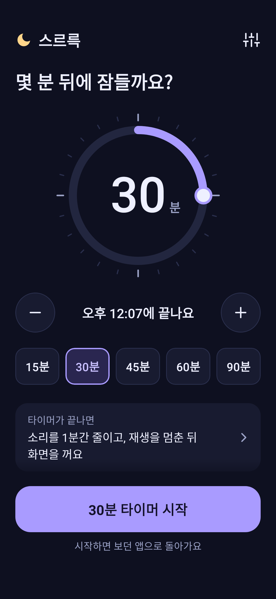
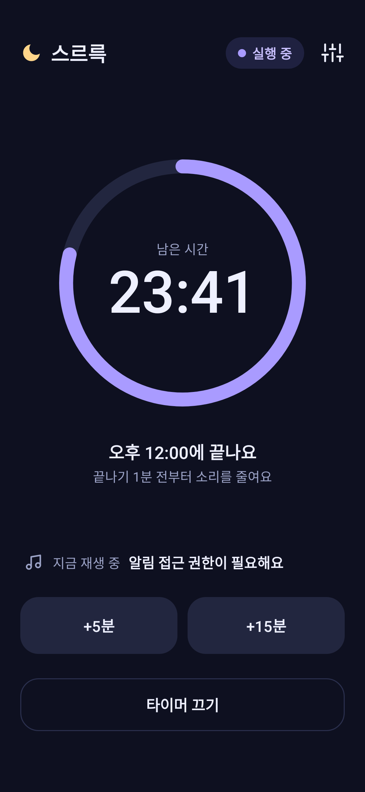
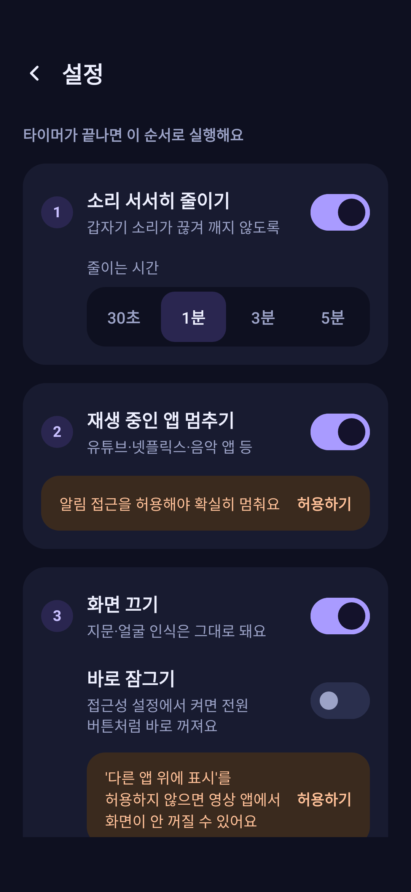

# 스르륵

영상이나 음악을 틀어 놓고 잠들어도 괜찮아요.
정해 둔 시간이 되면 **소리를 서서히 줄이고, 재생을 멈추고, 화면을 꺼** 드려요.

넷플릭스, 유튜브, 음악·팟캐스트 앱 어디서든 쓸 수 있어요.

  
  
  

> 지금은 테스트 버전(0.x)이에요. 불편한 점은 [여기](https://github.com/happybrown/srr/issues)에 알려 주세요.

## 설치

1. [최신 버전 페이지](https://github.com/happybrown/srr/releases/latest)에서 `.apk` 파일을 받으세요.
2. 받은 파일을 열어 설치하세요. "출처를 알 수 없는 앱"을 허용할지 물으면 허용해 주세요.

- Android 8.0 이상에서 쓸 수 있어요.
- "Play 프로텍트에서 확인되지 않은 앱"이라는 안내가 나올 수 있어요. 아직 Google에 등록하기 전이라 그래요. **세부정보 → 무시하고 설치**를 누르면 설치돼요.

## 사용법

1. 처음 열면 필요한 권한을 차례로 안내해요.
2. 다이얼을 돌리거나 15·30·45·60·90분 버튼을 눌러 시간을 고르고, **타이머 시작**을 누르면 보던 앱으로 바로 돌아가요.
3. 영상을 보다가 시작하려면: 알림창을 내려 **슬립 타이머** 타일을 누르세요. 누를 때마다 15분 → 30분 → 60분 → 끄기 순서로 바뀌어요.
4. 아직 안 졸리면:
   - 알림에서 **+5분**, **+15분**
   - 소리가 줄어드는 동안 영상 위에 뜨는 **+10분**
   - 휴대폰을 **흔들기** (실행 중엔 +5분, 소리가 줄어드는 중엔 +10분)
   - 소리가 줄어드는 중에 **볼륨 버튼**을 눌러도 10분 연장돼요.

끝날 때 어떻게 할지는 오른쪽 위 **설정**에서 바꿀 수 있어요. 소리를 줄이는 시간(30초~5분), 재생 멈추기, 화면 끄기를 각각 켜고 끌 수 있어요.

### 화면은 이렇게 꺼요

어느 방법이든 다음에 켤 때 지문·얼굴 인식을 그대로 쓸 수 있어요.

1. **바로 잠그기:** 접근성에서 '스르륵 바로 잠그기'를 켜 두면 전원 버튼을 누른 것처럼 바로 꺼져요. 가장 확실해요.
2. **취침 화면:** 바로 잠그기를 안 쓰면 검은 화면으로 영상을 덮고 밝기를 최저로 낮춘 뒤 잠시 후 꺼요. 넷플릭스처럼 멈춘 뒤에도 화면을 켜 두는 앱도 꺼져요. 중간에 화면을 누르면 바로 걷혀요.

## 권한이 필요한 이유

| 권한 | 쓰는 곳 |
|---|---|
| 알림 표시 | 남은 시간과 연장 버튼을 알림에 보여줘요 |
| 알림 접근 | 지금 재생 중인 앱을 찾아서 멈춰요. 알림 내용은 읽지 않아요 |
| 알람 및 리마인더 | 휴대폰이 잠들어 있어도 정확한 시간에 끝내요 |
| 배터리 최적화 제외 | 밤새 타이머가 꺼지지 않게 해요 |
| 다른 앱 위에 표시 | 취침 화면으로 화면을 확실히 끄고, 영상 위에 +10분 버튼을 띄워요 |
| 접근성 (바로 잠그기) | 끝나면 전원 버튼처럼 바로 꺼요. 화면 내용은 읽지 않아요 (선택) |
| 시스템 설정 변경 | 화면이 더 빨리 꺼져요 (선택) |

## 개인정보

- 어떤 정보도 모으거나 보내지 않아요.
- 인터넷은 새 버전이 나왔는지 확인할 때만 써요.
- 바꿨던 볼륨과 화면 꺼짐 시간은 끝나면 원래대로 돌려놔요.

## 자주 묻는 질문

**'알림 접근'이나 '접근성'이 회색으로 막혀 있어요.**
휴대폰 설정 → 애플리케이션 → 스르륵 → 오른쪽 위 ⋮ → **제한된 설정 허용**을 누른 뒤 다시 시도하세요. 파일로 받아 설치한 앱은 Android가 이렇게 한 번 더 확인해요.

**타이머가 제시간에 안 끝나요. (갤럭시)**
설정 → 배터리 → 백그라운드 사용 제한에서 스르륵이 '절전 상태 앱'에 들어 있다면 빼 주세요. 앱의 권한 안내에서 '배터리 최적화 제외'도 허용해 주세요.

**화면이 꺼지지 않아요.**
설정 → 화면 끄기에서 **바로 잠그기**를 켜 주세요. 접근성 권한을 쓰기 싫다면 '다른 앱 위에 표시'와 '시스템 설정 변경'을 허용해 주세요. 그러면 취침 화면이 영상을 가리고 10초쯤 뒤에 꺼져요. 그래도 안 꺼지면 설정 → **기능 점검**의 기록과 함께 [알려 주세요](https://github.com/happybrown/srr/issues).

**아침에 소리가 작아요.**
스르륵은 재생이 멈춘 걸 확인한 뒤에 볼륨을 원래대로 돌려놔요. 멈추지 않는 앱이 있으면 그 앱의 재생이 끝날 때까지 볼륨을 낮춰 둬요.

**업데이트는 어떻게 하나요?**
새 버전이 나오면 앱 홈 화면에 알려 드려요. 누르면 이 페이지가 열리고, 새 `.apk`를 받아 설치하면 돼요. 설정이나 기록은 그대로 남아요.

---

개발·배포 정보는 [docs/DEVELOPMENT.md](docs/DEVELOPMENT.md)에 있어요.
